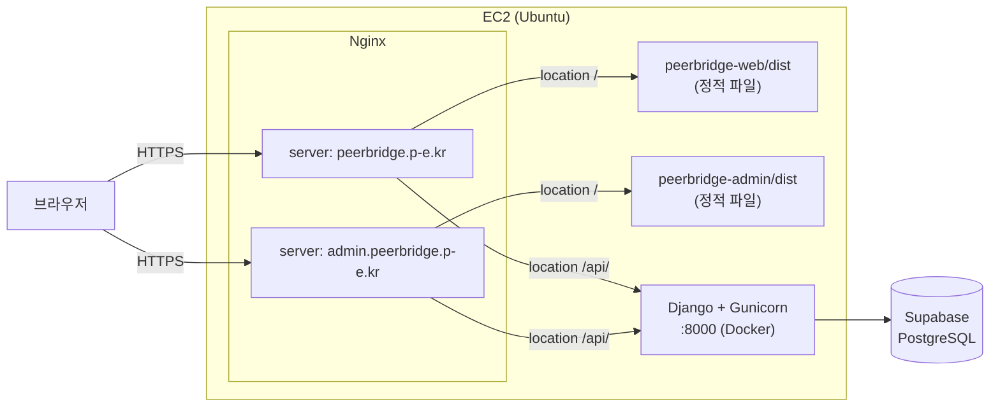
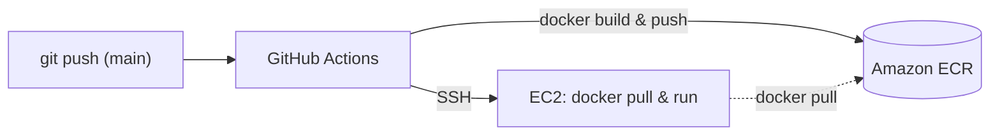

# peerbridge

P2P 대출 시뮬레이션 플랫폼. 차주(대출 신청자)와 투자자가 연결되어 대출 모집, 투자, 상환, 분배까지 전 사이클을 처리한다.

- 서비스: https://peerbridge.p-e.kr
- 관리자 콘솔: https://admin.peerbridge.p-e.kr

## 기술 스택

- Python 3.11, Django 4.2, Django REST Framework
- PostgreSQL (Supabase)
- JWT 인증 (djangorestframework-simplejwt)
- Docker, GitHub Actions (CI/CD), AWS ECR/EC2, Nginx, Let's Encrypt

## 아키텍처

단일 EC2 인스턴스에서 Nginx가 도메인별로 요청을 나눠서, 사용자용/관리자용 프론트는 정적 파일로 직접 서빙하고 `/api` 요청만 Django(Gunicorn) 컨테이너로 리버스 프록시한다. DB는 Supabase(PostgreSQL)를 사용한다.



### CI/CD

`main`에 머지되면 GitHub Actions가 이미지를 빌드해 ECR에 푸시하고, EC2에 SSH로 접속해 컨테이너를 교체한다. EC2에는 저장소 클론도, 별도 설정 파일도 필요 없다 — Docker와 IAM Role 기반 ECR 인증만 있으면 된다.



## 도메인 개념

### 사용자 (USER)

- 차주(borrower)와 투자자(investor) 역할을 동시에 수행 가능
- `balance`: 플랫폼 내 예치금 (실제 입출금 없는 가상 잔액)
- 모든 자금 이동은 LEDGER에 기록됨
- 플랫폼 계좌(시스템 User)가 따로 존재하며, 반올림 잔여분/이자 스프레드/연체가산이자가 여기로 귀속됨

### 대출 신청 → 대출 상품 흐름

1. 차주가 `LOAN_APPLICATION` 생성 (status=PENDING). 신청 시점엔 금액/목적/기간만 받고 금리는 받지 않음
2. 관리자 심사 → APPROVED 시 `LOAN` 생성 (status=FUNDRAISING). 이 시점에 관리자가 `interest_rate`/`investor_rate`를 함께 책정해 확정
3. 투자자들이 `INVESTMENT` 생성 → `funded_amount` 누적
4. 목표 달성 or 마감일 도래 → LOAN status=ACTIVE, 대출 실행
5. `REPAYMENT_SCHEDULE` 자동 생성 (원금균등상환, 원 단위 반올림)

### 상환 흐름

1. 차주가 회차별 `REPAYMENT` 납부
2. 정산일(`due_date`)이 되기 전에 미리 냈다면 분배는 정산일까지 보류 — 투자자는 원래 예정된 날짜에 받는다
3. 정산일이 되면 투자 비율에 따라 `DISTRIBUTION` 자동 생성 → 투자자 balance 증가 (원 단위 올림 지급, 올림 차액은 플랫폼 계좌에서 상계)
4. 모든 회차 완료 시 LOAN status=COMPLETED

### 이자율 구조

- `interest_rate`: 차주 연이율 (법정 최고 20% 이내)
- `investor_rate`: 투자자 수익률 (`interest_rate` 미만)
- 차액(스프레드)이 플랫폼 수수료
- 금리는 차주 자기신고가 아니라 관리자가 승인 시점에 신용도를 보고 책정

### 연체 처리

- LOAN status: `ACTIVE → OVERDUE_1 → OVERDUE_2 → DEFAULT → WRITTEN_OFF`
- 연체 시 약정금리에 연체가산금리를 더하되, 법정 최고금리(20%)를 초과하지 않음

### LEDGER 타입

| type | 설명 |
|------|------|
| CHARGE | 예치금 충전 |
| WITHDRAW | 예치금 출금 |
| INVEST | 투자 실행 (잔액 차감) |
| DISTRIBUTION | 상환 분배금 수령 |
| REPAY | 차주 상환 납부 (잔액 차감) |
| PLATFORM_FEE | 플랫폼 수수료 |

## ERD 요약

```
USER ──< BANK_ACCOUNT
USER ──< LOAN_APPLICATION ──○ LOAN ──< INVESTMENT >── USER
                                   ──< REPAYMENT_SCHEDULE
                                   ──< REPAYMENT ──< DISTRIBUTION >── INVESTMENT
USER ──< LEDGER
USER ──< NOTIFICATION
```

## App 구조

엔티티는 도메인 경계에 따라 app으로 분리했다. 독립적인 라이프사이클/서비스 로직이 없는 하위 리소스(BankAccount 등)는 소유 엔티티와 같은 app에 둔다.

| app | 엔티티 | 핵심 역할 |
|-----|--------|-----------|
| accounts | User, BankAccount | 회원, 인증, 예치금 잔액, 계좌 정보 |
| loans | LoanApplication, Loan | 대출 신청서(심사 전) / 승인된 대출 상품(모집·상환 대상) |
| investments | Investment | 투자자의 투자 행위 |
| repayments | RepaymentSchedule, Repayment, Distribution | 회차별 상환 계획 / 실제 상환 / 투자자별 분배 |
| ledger | Ledger | 모든 자금 이동 기록(원장) |

## API

| Method | Endpoint | 설명 | 인증 |
|--------|----------|------|------|
| POST | /api/auth/register/ | 회원가입 | - |
| POST | /api/auth/login/ | 로그인 (JWT) | - |
| GET/POST | /api/loans/applications/ | 내 대출 신청 목록 조회 / 등록 | 로그인 필요 |
| GET | /api/loans/applications/pending/ | 관리자용 심사 대기 목록 | 관리자만 |
| POST | /api/loans/applications/{id}/approve/ | 승인 (금리 확정, Loan 생성) | 관리자만 |
| POST | /api/loans/applications/{id}/reject/ | 거절 | 관리자만 |
| GET | /api/loans/ | 대출 상품 목록 (`?status=FUNDRAISING` 등 필터) | 비로그인 허용 |
| GET | /api/loans/{id}/ | 대출 상품 상세 | 비로그인 허용 |
| POST | /api/investments/ | 투자 실행 | 로그인 필요 |
| GET | /api/investments/mine/ | 내 투자 내역 | 로그인 필요 |
| GET | /api/investments/monthly-returns/ | 월별 수익 추이 | 로그인 필요 |
| GET | /api/loans/mine/next-repayment/ | 다음 상환 예정 회차 | 로그인 필요 |
| POST | /api/loans/{id}/repay/ | 상환 납부 | 로그인 필요 |
| GET | /api/ledger/ | 내 거래 내역 | 로그인 필요 |
| POST | /api/ledger/charge/ | 예치금 충전 | 로그인 필요 |
| POST | /api/ledger/withdraw/ | 예치금 출금 | 로그인 필요 |
| GET | /api/loans/admin/stats/ | 관리자용 플랫폼 통계 | 관리자만 |
| GET | /api/schema/, /api/docs/ | API 스키마 / Swagger UI | - |

## 로컬 개발 환경

```bash
cp .env.example .env   # DB_NAME/DB_USER 등 채우기
docker compose up -d
docker compose exec web python manage.py migrate
```

## 배포

`DEPLOY.md` 참고.
